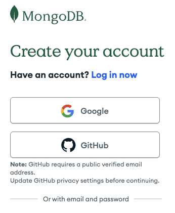
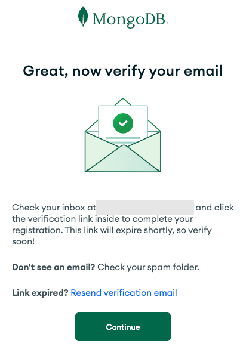
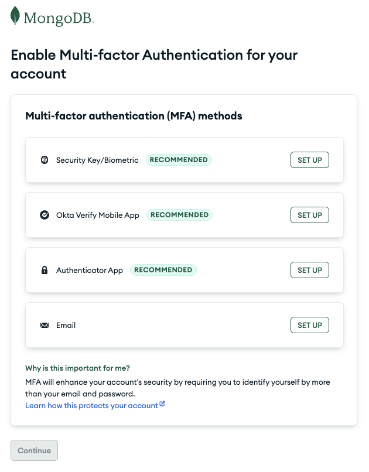
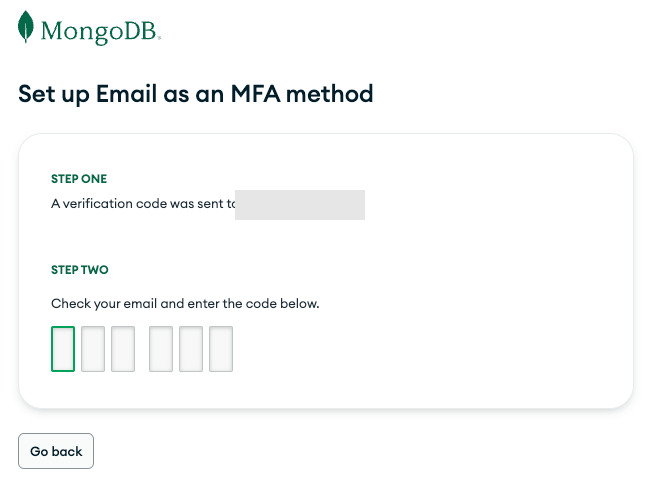
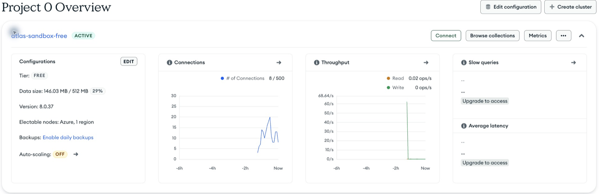
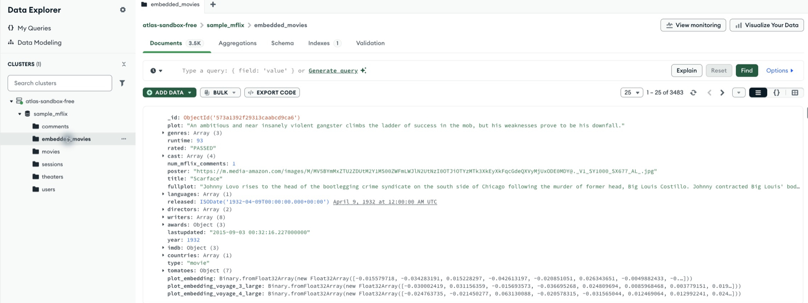
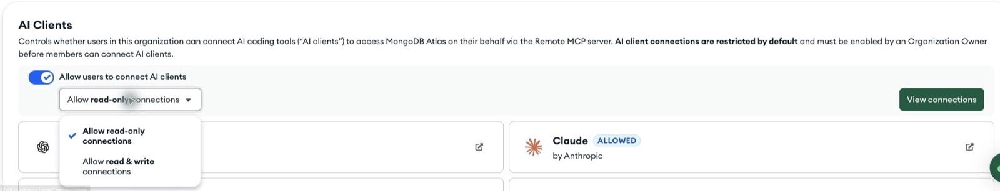
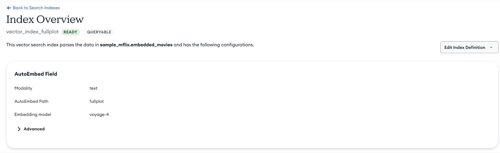
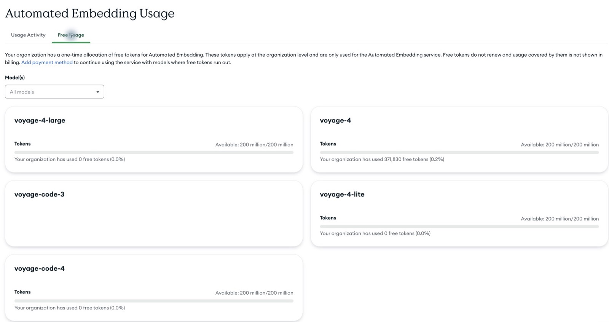

# Start from scratch

Create an Atlas account, prepare a Free cluster on Azure, load sample data, enable read-only remote MCP access, and configure Microsoft Foundry. Then follow the [agent connection and usage guide](usage.md).

You need an Azure account with an active subscription and permission to create a Foundry resource, project, and model deployment. You do not need an existing MongoDB account, a local SDK, a connection string, or an embedding function.

The remote connector's **Managed OAuth Identity Passthrough** flow was tested in a Microsoft/MongoDB pilot. Confirm that your Foundry catalog exposes that option before spending time preparing the environment. An Azure subscription alone does not establish pilot access.

## 1. Create your Atlas account

1. Open [MongoDB Atlas](https://cloud.mongodb.com/) and choose **Sign Up**.
2. Choose email/password or an offered identity provider. If using email, enter your address, first and last name, and a new password. Company name is optional. Review the privacy policy and terms, accept if you agree, and submit registration. Complete any CAPTCHA yourself.

   

3. Check your inbox and follow MongoDB's verification link. On the **Great, now verify your email** page, **Continue** becomes available once verification completes. Check spam or use **Resend verification email** if needed. Use the link in your own email, not a link copied from a screenshot.

   

4. If Atlas presents **Enable Multi-factor Authentication for your account**, choose **Set up** for a method appropriate to your account and organization. The observed options included a security key/biometric, Okta Verify, an authenticator app, and email. Complete the selected method and continue. Available methods may differ for another login provider or organization policy.

   

   The rehearsal used email MFA. For that route, Atlas sends a separate verification code: check your own inbox, enter it on **Set up Email as an MFA method**, and finish enrollment. This step is separate from verifying your email address. Use a recommended stronger method when required by your organization; email is an observed example, not a lab requirement.

   

5. Continue into Atlas. A new account may arrive at **Let's build something great**, with a free starter shortcut and **Customize your cluster**.

If you already use Atlas and want to rehearse the new-user journey, use a separate private browser session. Register with an unused account identifier. Keep Atlas and Foundry in that same private session for the later OAuth flow, so consent does not silently select your regular Atlas identity.

Atlas may generate an organization name from your personal name and a project named **Project 0**. These names do not affect the integration. For published screenshots, crop out the organization/account header and browser chrome. Use your own signed-in session.

## 2. Create a Free cluster on Azure

Use the customizable path so you can explicitly select Microsoft Azure. The **Set it up for me** shortcut selected AWS during the rehearsal; it did not offer provider selection on its first screen.

1. Choose **Explore my options** under **Customize your cluster**. In other layouts, open **Clusters → Build a Cluster** or **Create cluster**.
2. Select **Free**. MongoDB's current UI calls this tier Free; `M0` still appears in limits and API terminology.
3. Enter this general-purpose name:

   ```text
   atlas-sandbox-free
   ```

4. Select **Azure** as the cloud provider.
5. Select **Virginia-East2 (eastus2)** if available. This was the Free region offered and used in the rehearsal. Use a supported alternative if unavailable; do not select a paid tier just to match a region.
6. Keep **Preload sample dataset** checked.
7. Review **Automate security setup**. It is optional for this delegated remote MCP route. In the validated Azure setup it was unchecked, and Data Explorer and remote MCP still worked. This route does not require manually opening a database network rule or distributing a database password. Follow any connection-security requirements that Atlas actually presents for your selected client; the optional self-managed MCP route has different requirements.
8. Before submitting, verify **Free**, **Azure**, the intended region, the generic name, and the displayed cluster price of **$0/hour**. Decline optional paid additions unless you intend to use them.
9. Select **Create Deployment** and complete any CAPTCHA. Wait for provisioning to finish.

A Free cluster does not make Azure model inference or every optional Atlas service free. Embedding allowance and billing are reviewed separately below.

**Checkpoint:** the cluster card says **Tier: FREE** and **Azure**. If it says AWS, stop and correct the setup before continuing. Changing a Free cluster's provider in place requires scaling to a larger tier; recreating a disposable cluster is a separate destructive action. Do not delete a cluster containing your own data to follow this example.



Atlas generally allows one Free cluster per project. If Free is unavailable, check whether the project already contains one, including a paused or terminating cluster. A newly created project may be appropriate; do not upgrade a different cluster as a workaround.

See [deploy a Free cluster](https://www.mongodb.com/docs/atlas/tutorial/deploy-free-tier-cluster/) and [modify a cluster](https://www.mongodb.com/docs/atlas/scale-cluster/).

## 3. Verify the sample movie data

1. Close the generic **Connect** dialog if it offers drivers, Compass, and Shell. You do not need to copy a connection string for this integration.
2. Open **Data Explorer**.
3. Select `atlas-sandbox-free`. If it is disconnected, select its row and then **CONNECT**. A collapsed/disabled-looking tree alone does not establish that provisioning is still running.
4. Expand `sample_mflix`, then select `embedded_movies`.
5. Open documents and locate `title`, `year`, `genres`, and `fullplot`.

The fresh sample loaded during the rehearsal contained **3,483 documents**. It also contained `plot_embedding`, `plot_embedding_voyage_3_large`, and `plot_embedding_voyage_4_large`. Those precomputed vectors are useful for other examples. This example creates its own automated-embedding index over the text field `fullplot` instead.

If `sample_mflix` is absent after sample loading completes, open the cluster's actions menu and select **Load Sample Dataset**. Follow [Atlas's sample-data instructions](https://www.mongodb.com/docs/atlas/sample-data/load-sample-data/), then check the collection again. Do not assume the sample was loaded just because the cluster exists.



**Checkpoint:** you can read movie documents in `sample_mflix.embedded_movies`.

## 4. Allow read-only remote MCP access

This setting belongs to the **Atlas organization**, not the individual cluster.

1. Open **Organization Settings → App Connections**. If you are in project settings, return to the organization first.
2. Find **AI Clients** and **Allow users to connect AI clients**.
3. Enable AI client connections if disabled, with approval from your organization owner.
4. Set **AI client access level → Allow read-only connections**. Confirm Atlas reports the update and the selected option is read-only.



The fresh organization in this rehearsal already allowed AI clients with read & write access. We changed it to read-only; do not infer that the Free cluster tier causes that default, or that every new organization behaves the same way.

The connector acts on behalf of the authorizing Atlas user and is constrained by the organization's policy and that user's permissions. You do not need to enable write access for this example. See [manage AI client access](https://www.mongodb.com/docs/mcp-server/remote-mcp/manage-ai-client-access/).

**Checkpoint:** the intended identity can read the sample collection, and the organization's AI client access level is read-only.

## 5. Check the automated-embedding allowance

In the project, open **Search & Vector Search**, select the cluster, then **AUTO EMBEDDING → Usage → Free Usage**. Find **voyage-4**.

During the new-account rehearsal, Atlas showed **200 million unused free tokens** for that model. This is a one-time allocation shared across the organization, not a monthly allowance or a per-user allocation. Check your actual balance.

Open **AUTO EMBEDDING → Rate Limits** as well. The rehearsal's Tier 0 cluster displayed separate indexing and query limits of **10,000 tokens/minute and 3 requests/minute** for Voyage-4. Treat the live dashboard as the account-specific check; limits and product policies can change.

Automated Embedding generates vectors for existing text during the initial build and for the text of each semantic query. It does not reuse the collection's older vector fields. It stores its generated embeddings separately from application documents. An authorized owner creates the index; users with read-only access can query it afterward.

Review [embedding billing](https://www.mongodb.com/docs/vector-search/crud-embeddings/automated-embedding/billing/) and [how embedding works](https://www.mongodb.com/docs/vector-search/crud-embeddings/automated-embedding/overview/). Creating an index requires acknowledging possible token charges even without a payment method. Do not equate “no card on file” with a spending cap.

## 6. Prepare the automated-embedding index

Wait for indexing to complete before testing semantic queries.

1. In **Search & Vector Search**, select **CREATE SEARCH INDEX**.
2. Select **Vector Search** and **Automated Embedding**.
3. Enter the index name:

   ```text
   vector_index_fullplot
   ```

4. Expand `sample_mflix` and select `embedded_movies`.
5. Choose **Visual Editor**. Review the billing acknowledgment, accept it only if authorized, then select **Next**.
6. Set **Path** to `fullplot` and **Embedding Model** to `voyage-4`. No additional filter field is needed for the semantic query.
7. Select **Next** and review the collection, index name, text path, and model.
8. Select **Create Vector Search Index**. Wait for **READY / QUERYABLE**; indexed-document progress alone is not the final checkpoint.

The equivalent definition is:

```json
{
  "fields": [
    {
      "type": "autoEmbed",
      "modality": "text",
      "path": "fullplot",
      "model": "voyage-4"
    }
  ]
}
```



The sample loader also created a default full-text search index on `sample_mflix.movies` in our rehearsal. It does not replace the vector index on `embedded_movies`. The two together used two of the Free cluster's three search/vector index slots.

### Measure setup usage before testing

Before running a search, revisit **Usage → Free Usage**. The initial build for 3,483 documents reported **371,802 Voyage-4 tokens**, about **0.186%** of the observed 200-million allowance. This is a measured example, not a guaranteed cost for every sample version.

The first usage views showed zero even after the index was Ready; refreshing later exposed the consumed tokens. Do not report that initial zero as proof of no consumption. After our subsequent validation searches, the counter read **371,830**, as shown below. That later total is not the build-only figure.



### Check semantic retrieval directly in Atlas

Open **QUERY** for `vector_index_fullplot`. In **Search Tester**, enter:

```text
A group of astronauts struggles to survive a dangerous mission in space.
```

Select **Search** and inspect the returned documents. In the rehearsal, the top results included *Red Planet*, *Capricorn One*, and *Space Cowboys*. A match can be approximate; read the plots rather than treating similarity scores as confidence percentages. **Edit Query** shows the `$vectorSearch` query text, index, and path. It does not need a vector pasted by the user.

## 7. Prepare Microsoft Foundry

1. Open [Microsoft Foundry](https://ai.azure.com/) and use the **New Foundry** experience.
2. Open the project selector in the upper-left corner and select **Create new project** (or use the homepage's project-creation action). Under **Advanced options**, select your Azure subscription and a dedicated resource group for this example. If the resource group does not exist, create it through the offered resource-group link, then return and select it.
3. Use generic names such as:

   | Resource | Example |
   |---|---|
   | Resource group | `atlas-foundry-demo-rg` |
   | Foundry resource | `atlas-foundry-demo-resource` |
   | Foundry project | `atlas-foundry-demo` |
   | Agent | `atlas-movie-agent` |
   | MCP tool | `atlas-remote-mcp` |

   Add a short suffix if a resource name must be globally unique. A dedicated resource group makes later Azure cleanup easier; it does not contain or delete Atlas resources.

4. Choose a region supporting your model and the connector pilot. The Atlas cluster's Azure region and Foundry's region need not have identical labels for this internet-hosted MCP route. Confirm your organization's location requirements separately; automated-embedding inference uses its own scope settings.
5. Review **Set up recommended resources**. Application Insights can help diagnose agent traces but adds resources and monitoring charges. Know what is being provisioned.
6. Make a **GPT-5 Global Standard** deployment available to the project using the procedure below. Confirm sufficient quota under **Manage → Quota → Token per minute**; a deployment exists only if it was actually created, not merely selected in the catalog.
7. Record the model deployment name and check that response-level **Traces** are accessible. See [Foundry project guidance](https://learn.microsoft.com/en-us/azure/foundry/how-to/create-projects) for project creation details. Check model quota before testing; throughput allocation and billed usage are separate.

GPT-5 at low reasoning effort was validated here. No Azure embedding deployment is required for this automated-embedding path. Azure inference is billed separately from the Atlas free allowance.

### Deploy the chat model if none exists

Open **Discover → Models**, search for **gpt-5**, and open its model card. Select **Deploy → Custom settings** so you can inspect the deployment type and allocation. In a layout that starts from **Build → Models**, use its model-deployment action to reach the same model selection. Complete model deployment before creating the agent.

| Setting | Value to review |
|---|---|
| Model | `gpt-5`, the tested baseline, if available to this subscription |
| Deployment name | `gpt-5` or another name you record in your setup notes |
| Deployment type | **Global Standard**, matching the validated baseline |
| Version | Record the selected version; the validated trace used `gpt-5-2025-08-07` |
| Token allocation | Available quota sufficient for your rehearsal; inspect the actual deployment allocation afterward |

Select **Deploy** only after reviewing the settings and price. Wait for **Succeeded**, then confirm the deployment is visible to the intended Foundry project. In the agent editor, select that deployment; the instructions later set reasoning effort to **low**. Reuse an existing compatible deployment if your project already has one.

If the selected model/version or Global Standard capacity is unavailable, stop preparation and choose a region or alternative deployment that you can validate with the sample queries. If a request is throttled, inspect **Manage → Quota → Token per minute** for this deployment; allocated throughput is separate from billed token consumption.

See Microsoft's [model deployment procedure](https://learn.microsoft.com/en-us/azure/foundry/foundry-models/how-to/deploy-foundry-models) for current portal labels and required deployment permissions. No additional Azure OpenAI resource is needed merely to supply this agent's chat model when the selected Foundry resource already supports the deployment.

## 8. Record your environment details

In Atlas project settings, copy the actual project ID. Record your cluster name and project name. A new account may still use `Project 0`; do not substitute a different project just because its name looks more polished.

```text
Atlas project name: <your Atlas project name>
Atlas project ID: <your Atlas project ID>
Atlas cluster: atlas-sandbox-free
Database and collection: sample_mflix.embedded_movies
Index: vector_index_fullplot
Foundry project: <your Foundry project>
Foundry chat model deployment: <your deployment>
```

If testing with a new Atlas identity, open Foundry in the same private browser session and sign in to Microsoft there. Microsoft sign-in and MongoDB consent use separate identities. Creating a new Foundry connection alone does not prove that consent uses the desired MongoDB account; inspect **Logged in as** before authorizing.

Now follow the [agent connection and usage guide](usage.md) to create the agent, attach and authorize remote MCP, and verify real database retrieval.

## Finish and clean up

Review resource ownership before deleting anything. Keep `atlas-sandbox-free` if you intend to use it for other experiments. When finished, delete the dedicated Azure resource group only if all its resources belong to this example. Remove Atlas app authorizations and unwanted Atlas resources separately; deleting an Azure resource group does not remove them.
