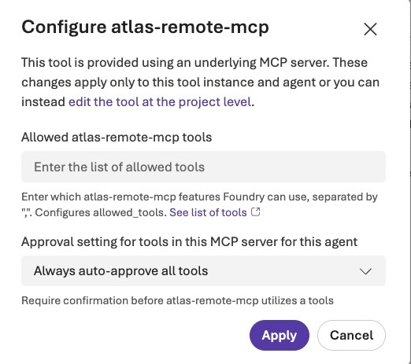
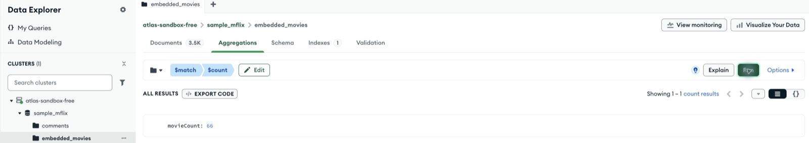
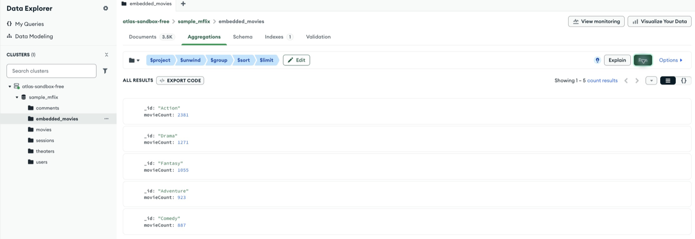
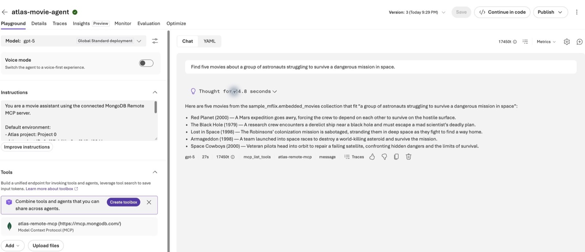
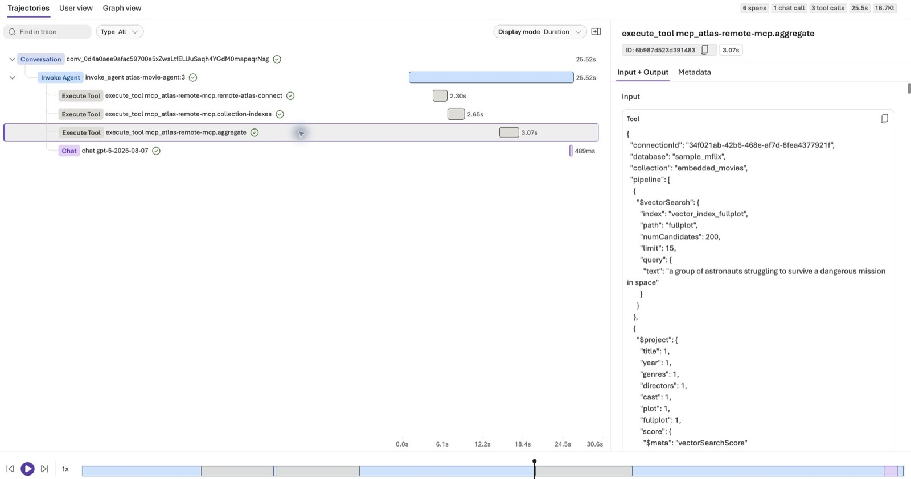

# Connect a Foundry agent to Atlas

Complete [setup from scratch](setup-from-scratch.md) first. Have your Foundry model deployment, Atlas project name, project ID, and cluster name available.

## Give the assistant a job

1. In your Foundry project, select **Create an agent**. From an existing project, use **Build → Agents**.
2. Name it `atlas-movie-agent`, select **Text**, and leave **Microsoft Copilot harness** unchecked for this configuration.
3. Select **Create**. In the playground, choose the model deployment prepared during setup. The tested baseline is **GPT-5**; open **Parameters** beside the model selector and set **Reasoning Effort** to **low**. Leave tool choice at **Let the model choose when to use**. Validate any alternative model using the same query and trace checks.
4. Open the [short agent instructions](agent-instructions.md). Replace the three Atlas placeholders and paste the text inside the code block into **Instructions**.
5. Select **Save**.

The prompt identifies the data and asks the agent to retrieve evidence. It contains no query examples or embedding code. We will inspect how the agent uses the available tools to do that work.

**Checkpoint:** the saved prompt contains your project ID and cluster name, with no remaining placeholders.

## Connect Atlas

1. Under **Tools**, check whether Foundry created a toolbox with Web search automatically. If so, open the toolbox's **Actions → Opt out** and confirm. Opting out keeps its tools attached; remove **Web search** separately through that tool's **Actions → Remove**. The toolbox is not required for this configuration.
2. Select **Add → Add tools → Catalog**, search for **MongoDB Atlas MCP Server**, and select the **Remote MCP** entry. The separate **MongoDB MCP Server** entry is labeled Local MCP and is not this route.
3. Complete the form:

   | Field | Value |
   |---|---|
   | Name | `atlas-remote-mcp` |
   | Remote MCP Server endpoint | `https://mcp.mongodb.com` |
   | Authentication | **OAuth Identity Passthrough** |
   | OAuth Provider | **Managed** |

4. Select **Connect**. The tool should appear directly in the agent's tool list. The tested configuration uses a direct attachment; see [toolbox troubleshooting](troubleshooting.md#a-toolbox-attachment-fails-but-the-direct-tool-works).
5. Open the tool's configuration. In this prepared read-only configuration, select **Always auto-approve all tools** under **Approval setting for tools in this MCP server for this agent**. Select **Apply**, then **Save** the agent. Reopen the tool configuration to verify the saved selection.



Restrict available Atlas access to read-only before enabling automatic approval. Auto-approval authorizes tool execution; it does not grant database permissions. For environments that require manual approval, follow your organization's policy and approve individual read-only calls instead.

You may not see an Atlas login yet. The first tool use can trigger sign-in and consent; we will trigger that next.

**Checkpoint:** the direct Atlas MCP tool is attached, Web search is off, and your agent is saved.

If the catalog item or **Managed** option is missing, check pilot availability in your tenant. See [troubleshooting](troubleshooting.md). The Atlas-hosted endpoint requires authentication.

## Get a number you can prove

Ask:

```text
How many movies were released in 1994?
```

If Foundry offers **Open consent**, open it, sign in with your intended Atlas identity, and complete authorization. Return to Foundry and allow the response to finish; retry the question if it does not resume. If a second consent request appears, complete it once. If consent keeps repeating, use [consent troubleshooting](troubleshooting.md#sign-in-succeeds-but-consent-repeats).

Confirm the MongoDB consent page shows the intended Atlas identity before authorizing. A normal browser may reuse your personal Atlas login; for a new-account rehearsal, keep Foundry and Atlas in the same private session. Microsoft sign-in and MongoDB consent are separate.

The agent should use your configured project and cluster. If it asks you to choose among many projects, check the three defaults in **Instructions**.

### Prove where the number came from

1. Select **Traces** beneath this response.
2. Find a successful MongoDB **count** or **aggregate** call.
3. Confirm it targets `sample_mflix.embedded_movies` with `year: 1994`, and its output contains the count shown in the answer.
4. In Atlas **Data Explorer → embedded_movies → Aggregations**, select **TEXT** beside **STAGES**. Paste the complete pipeline below, replacing any existing pipeline, then select **Run** (the accessibility label is **Run aggregation**). If you are already viewing results, select **Edit** first.

   ```json
   [
     { "$match": { "year": 1994 } },
     { "$count": "movieCount" }
   ]
   ```

**Checkpoint:** the Atlas count, MCP output, and assistant answer agree. The development dataset returned **66**; use the actual count in your collection. If the agent added a filter such as `type: "movie"`, include that filter when comparing counts and note the scope.



**Why this matters:** a familiar title could come from model knowledge. A database call and a matching count provide evidence that the assistant used live Atlas data.

## Turn the catalog into an insight

Close the trace panel and ask:

```text
Across all documents in this collection, what are the five most common genres, and how many documents belong to each? Count each document once in each genre it belongs to.
```

Inspect the response's trace. Look for an aggregation that expands the `genres` array, groups by genre, counts memberships, sorts, and limits the output. A movie can contribute to several different genres.

Compare the counts with the [Atlas verification pipeline](../samples/queries.md#verify-genre-counts-in-atlas), using the **TEXT** editor and **Run** as in the count example. This query explicitly includes all document types; the pipeline does the same. If the trace adds a `type: "movie"` filter, ask the agent to include all document types before comparing.



**Checkpoint:** all five counts agree with Atlas using the same filters. The agent chose an aggregation without you writing one in the chat.

**Why this matters:** the same connection can answer a quantitative business question, in addition to retrieving individual records.

## Find a story by meaning

Now take the viewer's role. You remember the kind of story you want, rather than a title or actor. Ask:

```text
Find five movies about a group of astronauts struggling to survive a dangerous mission in space.
```

The returned titles can vary. Read a couple of their plots in Atlas and decide whether they support the request. The validated new-account run recommended Red Planet, The Black Hole, Lost in Space, Armageddon, and Space Cowboys; these are examples, not required answers. Similarity scores rank retrieval and are not confidence percentages.



### Inspect the retrieval path

Open this response's **Traces** and select the successful MongoDB **aggregate** call. Confirm:

- It targets `sample_mflix.embedded_movies`.
- Its first pipeline stage is `$vectorSearch`.
- The index is `vector_index_fullplot`, the path is `fullplot`, and `query.text` contains the concept being searched.
- Atlas returned documents and those documents support the assistant's answer.

You may also see index discovery before the aggregation. The agent can discover the available index instead of requiring its name in the prompt.



**Checkpoint:** the trace proves a successful vector search using query text. A list of plausible titles alone does not establish semantic search.

**Why this matters:** Foundry chooses and invokes tools through MCP. Atlas performs retrieval over your catalog and generates embeddings through Automated Embedding. You did not deploy a separate embedding service.

If the agent used a regular expression or keyword search, this checkpoint has not passed. Open [semantic search troubleshooting](troubleshooting.md#the-answer-looks-semantic-but-the-trace-shows-keyword-search).

## Check a fresh conversation

Start **New chat** and repeat the semantic query. Inspect its trace again to verify retrieval without earlier conversation history. Titles may vary; successful tool execution and supporting plots are the evidence. See [additional queries](../samples/queries.md).
